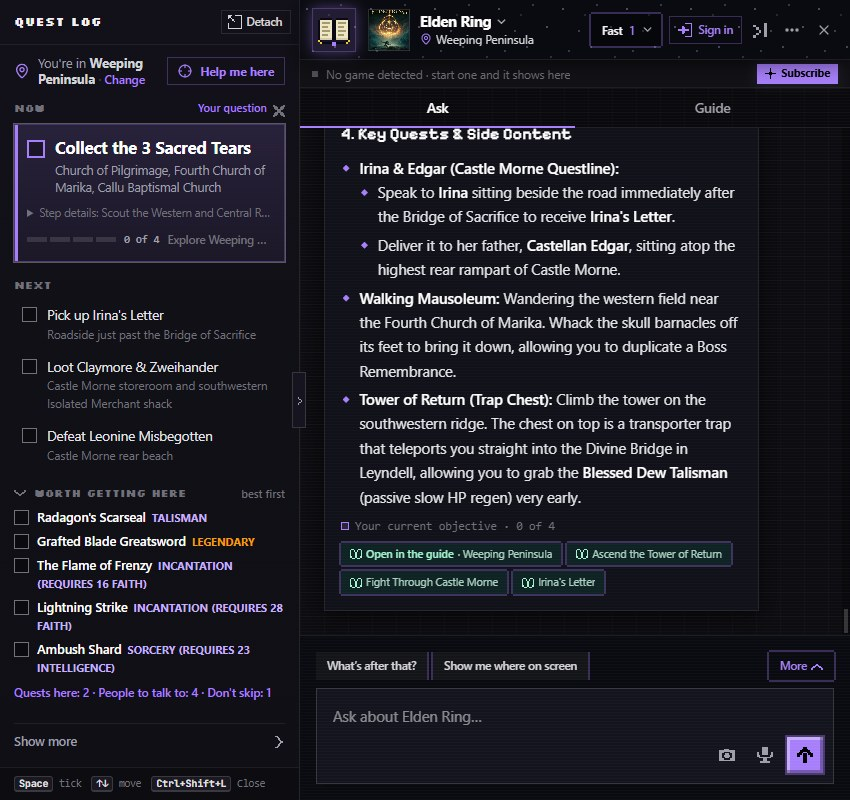
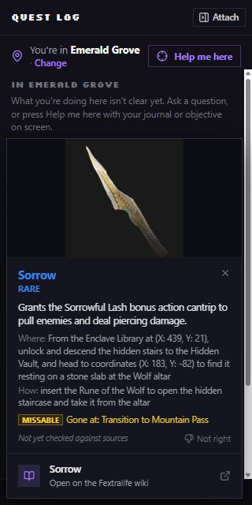

# Quest Compendium

An AI game companion that sits beside your game on Windows. Ask about what's on your screen and get an answer that
knows the game, where you are and what you're doing, for any game you play.

**[Download for Windows](https://github.com/TuriusX/Quest-Compendium/releases/latest/download/Quest-Compendium-Setup.exe)** ·
**[Microsoft Store](https://apps.microsoft.com/detail/9NN4DDKMD1X3)** ·
**[Steam Deck plugin](https://github.com/TuriusX/Quest-Compendium-Decky)** ·
**[questcompendium.com](https://questcompendium.com)**

## What it does

- **Answers about what's on your screen.** Ask by typing or holding to talk. A screenshot of your game goes with the
  question, so the answer fits where you actually are. Pick **Fast** for quick answers or **Pro** for harder ones.
- **Points at things on your screen.** When an answer is about something you can see, markers show where it is.
- **Pictures and videos.** When it helps, an answer comes with a wiki picture of the thing, or a video that starts at
  the right moment. Pin it beside the game in its own small window.
- **Sources.** Under an answer, the wiki and guide pages it came from (Fextralife, Fandom, IGN and others), one click away.
- **A quest log beside the game.** What you're doing now, the next steps and warnings before you can miss something.
  Tick steps off as you go, with the mouse, the keyboard or a controller.
- **Help me here** (Ctrl+Shift+K). One press looks at your screen (the map, your journal, place names), works out where
  you are and what you're doing, and sets the quest log to match.
- **Worth getting here.** For the area you're in, the gear, spells, quests and people worth your time, best first, with
  rarity in loot colours and a warning on anything you can miss. Hover an item for its card: a picture, what it does,
  where and how to get it, and a link to its wiki page. Works for any game; only things trusted sources back are listed.
- **Achievements here.** The Steam achievements still open in the area, with the ones you're about to lose first.
- **Finds your game.** Start a game and Quest Compendium switches to it. Link Steam for your achievements.
- **Stays out of the way.** The panel docks to the edge of the screen: one arrow (or Esc) tucks it away, and a tab
  between the quest log and the chat folds just the chat. Detach the quest log into its own window over the game.
- **Controller friendly**, and in nine languages: English, Spanish, Portuguese, German, French, Japanese, Korean,
  Russian and Chinese.

## Free and Premium

Everything works on the free plan. Premium gives you more questions every day.

| | Questions a day |
|---|---|
| Guest (no sign-in) | 1 Pro + 3 Fast |
| Free (signed in) | 2 Pro + 5 Fast |
| Premium, $4.99 a month or $39.99 a year | 8 Pro + 25 Fast, unused ones carry over (up to 100) |

Help me here has its own daily allowance, so it doesn't use up your questions. Cancel Premium any time.

## Install

- **Installer:** download [Quest-Compendium-Setup.exe](https://github.com/TuriusX/Quest-Compendium/releases/latest/download/Quest-Compendium-Setup.exe)
  and run it. The app updates itself. Every version is on the [Releases](../../releases) page.
- **Microsoft Store:** [Quest Compendium](https://apps.microsoft.com/detail/9NN4DDKMD1X3). The Store keeps it up to date.
- **Steam Deck:** see the [Quest Compendium Decky plugin](https://github.com/TuriusX/Quest-Compendium-Decky).

Windows 10 or 11. Sign in (Google or email) to keep your quest log and progress on all your devices.

## Privacy

Screenshots of your game are taken when you ask a question, when you press Help me here, and for a quick location check
when a game starts or you come back to it. They go to the Quest Compendium server and on to
Google's Gemini to produce the answer. Your quest log and progress are kept in your account when you're signed in.
See the [privacy policy](https://quest-compendium-890629309063.us-east1.run.app/privacy).

## Feedback

Use 👍 / 👎 or **Report** under any answer in the app, or open an [issue](../../issues) here.

## Built with

React, Vite, Tailwind CSS and Electron for the app; Node.js and Express on Google Cloud Run for the server; Firebase
(sign-in and database); Google's Gemini models for answers; Stripe for Premium.

Much of the code was written with the help of AI assistants (Claude, by Anthropic, and Google AI Studio), directed and
tested by the maintainer.
